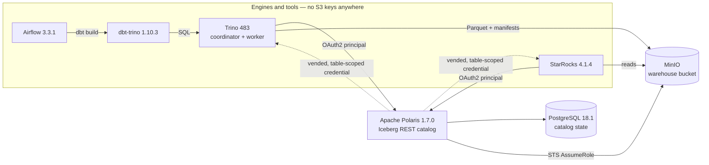

# lakehouse-lab

[](https://github.com/technobasant/lakehouse-lab/actions/workflows/ci.yml)

A working lakehouse: MinIO, Apache Polaris as the Iceberg REST catalog, Trino, dbt, Airflow and StarRocks — every image native arm64, nothing emulated. It is a 2024 architecture rebuilt on 2026 versions, and the part the 2024 build did not have turned out to be the interesting one: **credentials that expire**.

Every figure below came off this stack and is in [MEASUREMENTS.md](MEASUREMENTS.md) with the method that produced it. The four write-ups walk through it step by step, including the failures.

## What it proves

- **Engines hold no S3 key.** Trino and StarRocks authenticate to Polaris as an OAuth2 principal. Polaris checks a grant chain, calls MinIO's STS, and vends a short-lived credential scoped to one table's prefix. [`scripts/verify-scoping.sh`](scripts/verify-scoping.sh) takes that credential and tries to read what it should not: its own table is allowed, the sibling table and the bucket root are denied.
- **A medallion pipeline whose config is checked, not trusted.** dbt-trino builds silver by `MERGE` and gold from silver, orchestrated by Airflow 3. One dbt partition setting is accepted and silently discarded; `SHOW CREATE TABLE` and the `$snapshots` / `$files` metadata tables are the ground truth.
- **Maintenance and recovery that were performed, not described.** Twenty small files compacted into one. 909,968 deleted rows returned by `rollback_to_snapshot` in 589 ms — and then `expire_snapshots` shown destroying that same safety net.
- **One catalog, two engines.** StarRocks attached to the same Polaris catalog with one DDL statement and saw every table Trino wrote — no export, no copy, no re-registration, no S3 credential of its own.

## Architecture



| Component | Version | Role |
| --- | --- | --- |
| MinIO | RELEASE.2025-09-07T16-13-09Z | S3-compatible object storage, plus the STS that vending needs |
| Apache Polaris | 1.7.0 | Iceberg REST catalog and authorisation boundary |
| PostgreSQL | 18.1 | Polaris and Airflow metadata, so the catalog survives a restart |
| Trino | 483 | SQL engine, coordinator and one worker |
| dbt-core / dbt-trino | 1.12.2 / 1.10.3 | bronze → silver → gold |
| Apache Airflow | 3.3.1 | land → transform → maintain |
| StarRocks | 4.1.4 (allin1) | second engine on the same catalog |

## Quick start

You need Docker with about 8 CPUs and 12 GB of memory (the configuration it was measured on) and `curl`. Every credential in this repository is a **dev-only default** for a private compose network — see [Limits](#limits).

```bash
# 1. Storage, catalog and Trino. Wait until polaris and trino-coordinator report healthy.
docker compose up -d

# 2. Create the catalog and the grant chain (principal → principal_role → catalog_role → catalog).
#    Idempotent: a second run answers 409 and carries on.
./scripts/create-catalog.sh

# 3. Land TPC-H scale factor 1 into bronze, through Polaris.
docker compose exec -T trino-coordinator trino < sql/01-bronze.sql

# 4. Prove the vended credential cannot leave its table.
docker run --rm --network lakehouse_default -v "$PWD/scripts:/s:ro" \
  --entrypoint bash amazon/aws-cli:latest /s/verify-scoping.sh
```

Expected from step 4:

```text
credential vended for bronze.orders
  prefix: s3://warehouse/lakehouse/bronze/orders-<table uuid>
using only that credential:
  own prefix                         ALLOW  84 objects
  sibling bronze.customers           DENY   AccessDenied
  whole warehouse bucket             DENY   AccessDenied
```

Then the rest of the series:

```bash
# Medallion with dbt (part two)
docker compose --profile tools run --rm dbt debug
docker compose --profile tools run --rm dbt run

# The same pipeline under Airflow — UI on http://localhost:8081, DAG `lakehouse_pipeline`
docker compose --profile orchestration up -d

# A second engine on the same catalog (part four)
docker compose --profile engines up -d starrocks
docker compose exec -T starrocks mysql -h127.0.0.1 -P9030 -uroot < sql/starrocks-catalog.sql

# A Trino shell for the compaction, rollback and expiry steps (part three)
docker compose exec trino-coordinator trino

# Tear everything down, volumes included
docker compose --profile orchestration --profile tools --profile engines down -v
```

`scripts/bench.sh` times queries against Iceberg and Trino's in-memory `tpch` generator. It measures wall clock around the CLI, which is fine for a quick comparison and wrong for publishing: `docker compose exec` plus the CLI's own JVM startup adds about 515 ms to every run. The published figures were read server-side with [`sql/server-side-timings.sql`](sql/server-side-timings.sql).

## Results

Measured on 2026-08-16, Apple M-series host, Docker Desktop with 8 CPUs and 11.67 GB. Query timings are server-side medians of 5–7 runs after 2 warm-ups. Full detail in [MEASUREMENTS.md](MEASUREMENTS.md).

| What | Result | Method |
| --- | --- | --- |
| Ingest | 1,500,000 rows in 5.4 s → 80 Parquet + 2 Avro + 1 Puffin + 1 `metadata.json`, 16 MiB | `CREATE TABLE … AS SELECT` from `tpch.sf1`, objects counted with `mc ls` |
| One-month partition predicate | **88 ms** on Iceberg vs 615 ms on the `tpch` generator | `system.runtime.queries` |
| Scan + aggregate, 1.5M rows | 183 ms vs 238 ms | `system.runtime.queries` |
| Non-partition predicate | 202 ms vs 595 ms | `system.runtime.queries` |
| dbt `partitioning` at config level | ignored: 2 files, 0 partitions, 131 ms | same model and predicate, `$files` / `$partitions` |
| dbt partitioning via `properties` | 80 files, 80 partitions, 99 ms | same model and predicate |
| Incremental `MERGE` | 25,000 rows in 2.66 s, 1 of 81 files touched | dbt log and `$snapshots` |
| Compaction | 20 files → 1, 1,006 KB → 430 KB, partition query 184 ms → 69 ms, in 1.4 s | twenty 5,000-row inserts, then `EXECUTE optimize`, counted from `$files` |
| Rollback | **909,968 rows** recovered in 589 ms | `DELETE`, then `EXECUTE rollback_to_snapshot` |
| Snapshot expiry | 25 snapshots → 1; time travel to the old snapshot then fails | `expire_snapshots(retention_threshold => '0s')` |
| Two engines, one table | 1,645,100 rows in both; same aggregate 99 ms on Trino, 34 ms on StarRocks | Trino `system.runtime.queries`, StarRocks `fe.audit.log` `Time=` |

The StarRocks figure is one partition-pruned aggregate — the shape a vectorised MPP engine is built for. It says nothing about federation or large joins, which is where Trino is chosen. The useful result is not which is faster; it is that the question can be measured on the same tables without migrating anything.

## Decisions

| Decision | Alternative | Why |
| --- | --- | --- |
| Apache Polaris as the catalog | Hive Metastore, AWS Glue | A metastore says where a table is. Polaris decides who may touch it and vends short-lived, prefix-scoped credentials, so no engine holds a standing key — and the boundary held for two different engines. |
| Postgres-backed Polaris | the in-memory default | The point of a catalog is surviving a restart. Bootstrap runs as an idempotent init step, not a script someone must remember not to run twice. |
| Trino for SQL and dbt | Spark SQL | Interactive SQL, a mature dbt adapter, and federation, without starting a cluster per query. Spark appears where code transforms are the point, in the RAG half. |
| StarRocks as the second engine | a second Trino, DuckDB | A different engine architecture reading the same catalog is the real test that the catalog, not an engine, is the system of record. |
| MinIO with STS | LocalStack, real S3 | MinIO implements `AssumeRole`, which vending requires — at the price of three S3-isn't-MinIO workarounds, all commented in the config. |
| dbt inside the Airflow image | `DockerOperator` | The alternative mounts the Docker socket into Airflow, a real privilege escalation to save one `pip install`. Both images pin `dbt-trino==1.10.3`, so a DAG run and a manual run cannot drift. |

## Failures worth knowing before you start

Each of these is commented where it is fixed, and most of them fail in a way that points somewhere else.

- Polaris on an empty Postgres starts, reports healthy, and fails every request with `relation "polaris_schema.entities" does not exist`. The schema is the admin tool's job, and it must run first.
- MinIO refuses `AssumeRole` for its root user with `Unsupported action AssumeRole`, which reads like STS is missing. It is refusing that identity.
- Without `kmsUnavailable: true`, `CREATE TABLE AS SELECT` succeeds — data written — and every `SELECT` then fails with `Failed to load table`. Polaris adds a KMS statement MinIO's policy engine rejects.
- Polaris answers 403 to drop-with-purge by default, which breaks `dbt run --full-refresh` with a Trino error that never mentions purge.
- `partitioning` at dbt config level is accepted and produces an unpartitioned table. It belongs in `properties`.
- dbt's default schema naming turns `+schema: silver` into `silver_silver`. The macro in `dbt/macros/` makes the layer names mean what they say.
- `iceberg.register-table-procedure.enabled` alongside vended credentials stops Trino 483 from starting at all.

## Limits

- **One host.** Every service runs on one machine, so the timings are honest ceilings for 8 CPUs and 11.67 GB, not production numbers, and TPC-H SF1 is small enough that they reflect planning and pruning more than throughput.
- **Tested on arm64 only.** Every image publishes a native arm64 manifest; amd64 has not been run here.
- **Lab topology.** One Trino worker, StarRocks allin1, Airflow `standalone` — production splits all three.
- **Two pieces were reconstructed when this repo was packaged, and have not been re-run end to end.** The original lab created `bronze.customers` interactively and never saved the statement, so the one in `sql/01-bronze.sql` is a reconstruction; the `trino_lakehouse` Airflow connection is now defined in `docker-compose.yaml` instead of by hand. The figures in [MEASUREMENTS.md](MEASUREMENTS.md) come from the original runs. If a fresh clone disagrees with them, open an issue — that is a bug in the packaging, not a result.
- **Dev-only credentials, in plain text.** `lakehouse-dev-only`, `s3cr3t-dev-only` and friends exist so a clone runs with no setup. The compose file takes overrides from the environment (`MINIO_ROOT_PASSWORD`, `POLARIS_ROOT_SECRET`, `POLARIS_DB_PASSWORD`, `MINIO_STS_PASSWORD`, `AIRFLOW_DB_PASSWORD`), but the Polaris root credential is also written in `trino/*/etc/catalog/lakehouse.properties` and `sql/starrocks-catalog.sql`. HTTP everywhere and an all-admins Airflow UI: this is not a hardening guide.

## Write-ups

1. [A lakehouse spine: Trino, Iceberg and Polaris, with credentials that expire](https://basantbhattarai.com.np/writing/trino-iceberg-polaris-lakehouse-spine/)
2. [Bronze, silver, gold on Iceberg: the dbt config that is silently ignored](https://basantbhattarai.com.np/writing/dbt-trino-iceberg-medallion-airflow/)
3. [Iceberg maintenance: 20 files into 1, and a rollback I actually performed](https://basantbhattarai.com.np/writing/iceberg-compaction-snapshots-rollback/)
4. [Two engines, one Iceberg catalog: StarRocks beside Trino, neither holding a key](https://basantbhattarai.com.np/writing/starrocks-trino-one-iceberg-catalog/)

The retrieval layer's first version (July 2025: Spark 3.5, Parquet and DuckDB, Chroma) is public in [rag-pipeline](https://github.com/technobasant/rag-pipeline). The 2026 rebuild on Delta that [the RAG lakehouse post](https://basantbhattarai.com.np/writing/rag-lakehouse-delta-spark-chroma/) describes is not published yet. Both halves together: [the lakehouse and RAG case study](https://basantbhattarai.com.np/work/lakehouse-rag-lab/).

## Licence

Apache 2.0 — see [LICENSE](LICENSE) and [NOTICE](NOTICE).
